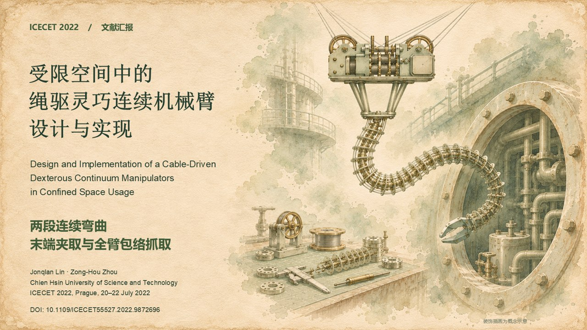
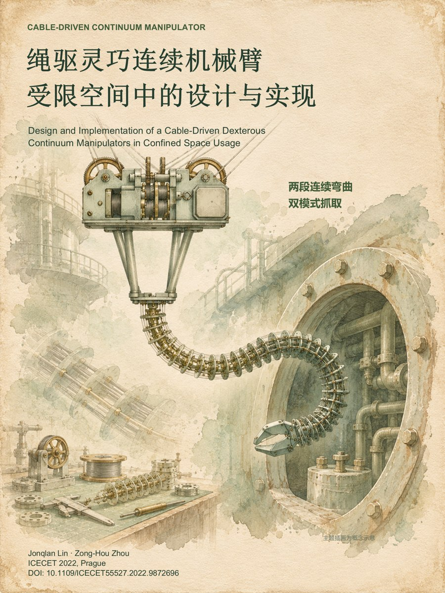
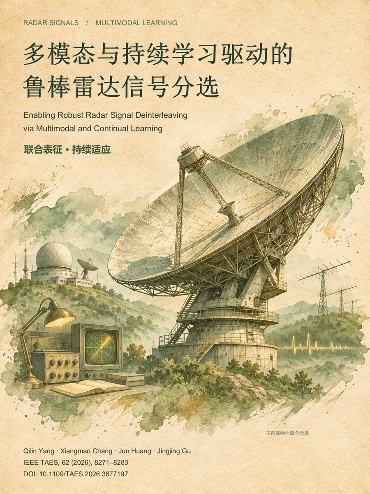
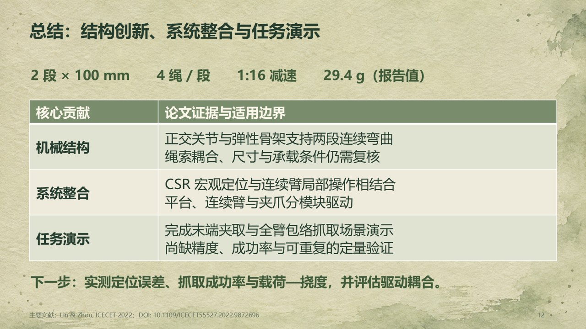
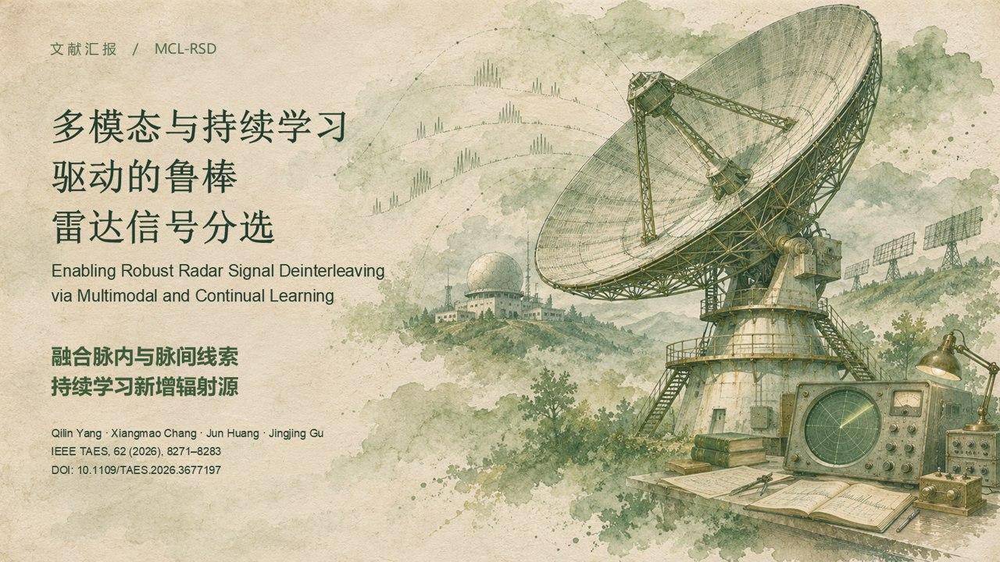
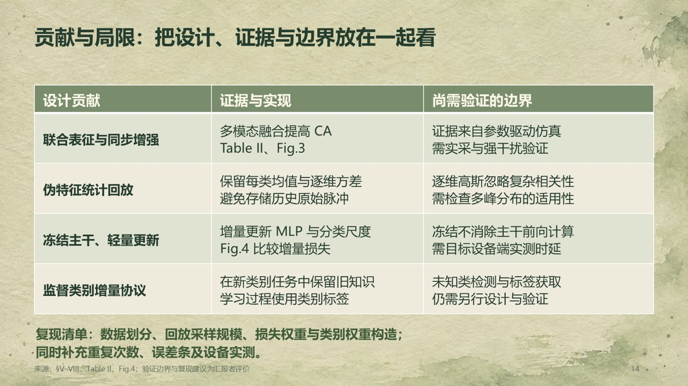

# Paper to Visual

**One research paper. An editable presentation. A matching vintage ink-wash poster.**

Paper to Visual is a reusable agent skill for turning research papers into clearly structured presentations and distinctive poster covers. It combines evidence-based paper analysis with a consistent visual identity: aged paper, muted sage greens, tactile grain, and topic-specific ink-wash collage.

It was refined through actual paper presentations, including feedback on color, texture, text hierarchy, line spacing, and underfilled slides. The examples below are screenshots of those outputs, not mockups of a future feature.



## What it produces

| Deliverable | What to expect |
| --- | --- |
| Presentation | A complete `.pptx` with editable titles, body text, annotations, tables, and reliably reconstructed charts |
| Poster cover | An independently composed portrait `.png` using the same visual language |
| Previews | Rendered slides and poster for full-size and thumbnail review |
| Paper notes | Source metadata, key findings, limitations, and page, section, or figure locations |
| Design notes | The visual subject, supporting motifs, palette, typography, and composition decisions |
| Optional poster source | An editable source file when the authoring environment supports it and actually creates it |

Original paper figures and generated artwork may remain raster images. Editable output does not mean that pixels inside an experimental photograph or illustration become editable objects.

**This repository contains the skill instructions and example screenshots. It is not a standalone application, a bundled image model, or a one-command rendering engine.**

## Visual identity

- **Muted green palette:** sage, celadon, moss, and selective dark gray-green details on light aged ivory.
- **Visible texture:** paper fibers, fine grain, pigment deposits, broken brushwork, and soft ink diffusion.
- **A subject for each paper:** research objects, apparatus, and relevant scenes replace generic paint-splash backgrounds.
- **Readable information:** deliberate text hierarchy, comfortable spacing, and evidence organized into meaningful groups.
- **Purposeful density:** underfilled pages are redesigned around sourced explanation and evidence instead of merely enlarging text or spreading sentences apart.

The style avoids full-page saturated dark green, neon effects, smooth generic wave backgrounds, and tiny rectangular illustrations floating on empty pages.

## Examples

All screenshots below are from real generated artifacts. Their presentation language is Chinese, while the repository documentation is English. You can explicitly request English slides and poster copy.

### 1. Cable-driven continuum manipulator

**Paper:** Jonqlan Lin and Zong-Hou Zhou, *Design and Implementation of a Cable-Driven Dexterous Continuum Manipulators in Confined Space Usage*, ICECET 2022. [Paper DOI](https://doi.org/10.1109/ICECET55527.2022.9872696).

The 12-slide example explains the two-section mechanism, suspension platform, actuation and control, two grasping demonstrations, and the limits of the reported evidence. The poster uses a mechanical subject specific to this paper.

<table>
  <tr>
    <td width="50%"></td>
    <td width="50%"></td>
  </tr>
  <tr>
    <td><strong>Continuum manipulator:</strong> a flexible, disk-based arm and cable-suspended platform.</td>
    <td><strong>Radar learning:</strong> an antenna, observation setting, and scientific apparatus.</td>
  </tr>
</table>

The two poster subjects differ; their paper texture, sage palette, and ink integration remain consistent. These are decorative conceptual illustrations, not photographs of the papers' actual devices.



*A content slide groups contributions with their supporting evidence and limitations. It keeps the background secondary to the message.*

### 2. Multimodal and continual radar learning

**Paper:** Qilin Yang, Xiangmao Chang, Jun Huang, and Jingjing Gu, *Enabling Robust Radar Signal Deinterleaving via Multimodal and Continual Learning*, IEEE TAES, 2026. [Paper DOI](https://doi.org/10.1109/TAES.2026.3677197).

This example uses a radar-themed cover and connects method choices with experimental evidence and the boundaries of the conclusions.





*The examples illustrate different information structures within one visual style. Source PDFs and the complete research decks are not included in this repository.*

## Requirements

The agent environment needs the following capabilities. Installing this repository does not install or authorize them.

| Capability | Why it is needed |
| --- | --- |
| Paper access | Read a local PDF, supplied full text, or accessible paper URL |
| Image generation or suitable supplied artwork | Produce the subject-specific vintage collage |
| Editable PPTX authoring | Create native text, tables, annotations, and supported charts |
| Presentation rendering | Review actual slides for clipping, overlap, density, and readability |
| Image export | Deliver the poster and previews at the stated dimensions |

Use the host's available PDF, presentation, and image tools. No fixed vendor, operating system, local path, or model is hardcoded in the skill. Rendering and font availability can differ across environments. Do not claim the visual workflow is complete when a required capability is missing.

## Install

Install the repository as a folder named `paper-to-visual` in a skills location supported by your agent. The folder must contain `SKILL.md`, `references/`, and `agents/`.

For a project-scoped Codex installation, run the following from your project directory:

```bash
mkdir -p .agents/skills
git clone https://github.com/XiaoHou517/paper-to-visual.git .agents/skills/paper-to-visual
```

PowerShell equivalent:

```powershell
New-Item -ItemType Directory -Path .agents/skills -Force | Out-Null
git clone https://github.com/XiaoHou517/paper-to-visual.git .agents/skills/paper-to-visual
```

The destination must not already contain another checkout. For a user-wide setup, use your agent's supported personal skills directory. See the [official skill documentation](https://learn.chatgpt.com/docs/build-skills) for current discovery locations and invocation behavior. If the skill does not appear after installation, restart the agent session.

## Use

Attach a paper PDF, then invoke the skill:

```text
Use $paper-to-visual to turn the attached paper into an editable
presentation and a matching poster cover. Follow the saved personal style.
```

For an English journal-club presentation:

```text
Use $paper-to-visual on this paper. Create 12 slides and a matching
portrait poster cover, both in English. Explain the methods and evidence,
and distinguish the authors' findings from presenter commentary.
```

For a targeted layout revision:

```text
Use $paper-to-visual to improve these underfilled slides. Keep the accepted
backgrounds. Reorganize the explanation, evidence, and limitations;
do not solve the problem only by increasing font size or line spacing.
```

For a standalone poster:

```text
Use $paper-to-visual to create only a poster cover for this paper.
Use the paper's research object as the central subject, retain the vintage
sage ink-wash style, and keep the title and citation accurately typeset.
```

A DOI or URL also works when the agent can access the source. Full text is preferable. If the paper is inaccessible, provide the PDF rather than asking the agent to invent missing content.

## Defaults and customization

| Setting | Working default | How to change it |
| --- | --- | --- |
| Language | Chinese, preserving the original paper title | Specify English or another language in the prompt |
| Slide format | 16:9 | Specify the required ratio |
| Slide count | About 10-15, adjusted to substance | Specify a count or presentation duration |
| Poster | Portrait 3:4 | Specify platform or print dimensions |
| Poster export | Target at least 1800 x 2400 pixels | Specify resolution; image upscaling does not add native detail |
| Visual style | Vintage sage ink-wash collage | Edit the profile or give a task-specific override |

Edit [references/personal-style.md](references/personal-style.md) for lasting preferences. Edit [references/visual-authoring.md](references/visual-authoring.md) for composition, density, typography, and review guidance. A one-paper exception belongs in that task's design notes rather than silently becoming a permanent rule.

## Scientific and visual quality

The workflow requires source traceability, honest handling of missing data, and rendered review. It preserves units, comparison conditions, and uncertainty; separates evidence from decoration; and avoids presenting illustrative artwork as experimental results.

Visual review checks the full-size slides and thumbnails for hierarchy, topic recognition, text density, line spacing, contrast, clipping, and overlap. A clean file export alone is insufficient. Published examples show the intended outcome, not a guarantee that every model or tool combination will reproduce identical results.

## Repository contents

```text
paper-to-visual/
|-- SKILL.md
|-- README.md
|-- agents/
|   `-- openai.yaml
|-- references/
|   |-- personal-style.md
|   `-- visual-authoring.md
`-- docs/
    |-- ATTRIBUTION.md
    `-- images/
        |-- continuum-cover.jpg
        |-- continuum-poster.jpg
        |-- continuum-summary.jpg
        |-- radar-cover.jpg
        |-- radar-poster.jpg
        `-- radar-evidence.jpg
```

## Attribution

Paper authors and sources are listed above and in [the attribution notes](docs/ATTRIBUTION.md). Screenshots demonstrate generated layouts and cited research summaries. Source papers, third-party reference screenshots, access credentials, and machine-specific build artifacts are not distributed here.
